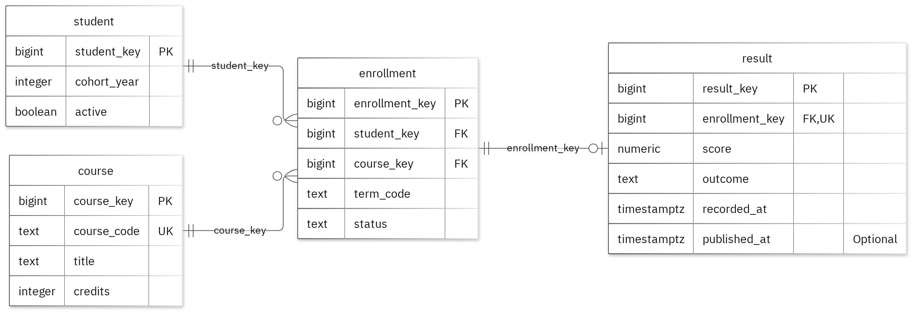

# MIT 8103 Advanced Database Systems

**University Student Result Portal** · OMOTOLA OGUNDARE · Student ID 301920243

## Case study
My case study focuses on a University Student Result Portal, a system designed to manage student academic records efficiently. The database enables students to view their published results, instructors to record assessment scores, and registrars to manage courses and student enrollments. The system consists of key entities such as Student, Course, Enrollment, and Result. It supports essential academic processes, including course registration, recording and publishing assessment results, generating student transcripts, and producing summaries of published results by course and academic term.

## Portfolio 1: Database Design and Modelling

I structured the database into four well-defined tables, with primary keys uniquely identifying each record and foreign keys maintaining relationships between the tables. Business rules are enforced through constraints, including a validation rule that ensures all recorded scores fall between 0 and 100. The normalization process was demonstrated through examples progressing from First Normal Form (1NF) to Second Normal Form (2NF) and finally Third Normal Form (3NF). To test data integrity, 28 intentionally invalid records were submitted and correctly rejected by the database, while all valid sample data remained unaffected.

Figure 1. Tables, keys and relationships. PK: primary key; FK: foreign key; UK: unique value.

<!-- PAGE BREAK -->

## Portfolio 2: Query Processing and Optimisation

I ran four SQL queries against the sample records. The join returned 1 rows and included 2026S with SYN101. For the index comparison, I used 25,000 separate performance rows. The median lookup time changed from 1.239 ms to 0.198 ms. Both phases returned the same records. The measured plan used the new index. These timings apply to this lookup and environment.

## Portfolio 3: Transactions and Concurrency

To demonstrate transaction management and concurrency control, I used a temporary counter within the Enrollment table. This allowed me to test COMMIT, ROLLBACK, and the READ COMMITTED isolation level without affecting the core business data. During testing, uncommitted changes made in one session were not visible to another session, confirming the isolation behaviour. When a transaction was rolled back, the counter returned to its last committed value. I also simulated concurrent updates: without locking, two separate increments resulted in a final counter value of 2, illustrating a lost update scenario. After implementing SELECT FOR UPDATE, the second session waited for the first to complete, and the final value correctly became 3. The temporary counter was used solely for testing purposes, while the original case study data and business attributes remained unchanged.

## Portfolio 4: NoSQL and Advanced Data Models

For the NoSQL implementation, I used a portal_events collection to store event-based documents related to the case study. Using MongoDB, I successfully inserted two sample event records and verified the solution with four queries, all of which returned the expected results. Data validation rules worked as intended, rejecting records with an invalid date format as well as duplicate event IDs. The document structure uses embedded snapshots to keep related information together within each event, while allowing the details field to vary depending on the event type. The events used for testing are entirely fictional, and the relational database in PostgreSQL continues to enforce the core business rules and relationships of the system.

## Repository and evidence

https://github.com/temitolawilliams/OGUNDARE_OMOTOLA_301920243

The portfolio folders contain the SQL and JavaScript, explanations, query plans, result tables and screenshots.

<!-- PAGE BREAK -->

## Portfolio 5: Distributed and Cloud Database Exercise

For the distributed database component, I proposed a MongoDB replica set consisting of three members deployed across separate failure zones to improve system resilience and availability. The discussion examines key concepts such as primary elections, majority write acknowledgements, secondary replica lag, and the trade-offs involved in sharding the portal_events collection. Replication helps ensure that the system remains available when a node fails, while regular backups provide a recovery mechanism in the event of data loss or corruption. Since the relational database and MongoDB store different types of data, PostgreSQL would require its own high-availability and disaster recovery strategy. This portfolio focuses on the approved discussion-based approach; therefore, no live replica set or failover testing was implemented.

## Individual reflection

I kept student, course, enrollment, result in separate tables so their details could be maintained without repeating them in every related record. A recorded score must be between zero and one hundred inclusive. The constraint tests check this alongside the required values and record links. One issue illustrated by the two-session exercise is that both sessions can read the same value before either update is committed. Locking the row before reading preserves both increments. The index comparison also shows why I need to check the execution plan as well as the final answer: the same result can require different amounts of database work.

## AI-use declaration

I used GitHub Copilot and AI-assisted tools to support the development of the database model, SQL scripts, and documentation. These tools helped with drafting code, checking syntax, and improving explanations. All database design decisions, testing activities, result verification, and final submissions were reviewed and validated by me. I take full responsibility for the submitted work.

## References

- [PostgreSQL: constraints](https://www.postgresql.org/docs/17/ddl-constraints.html)
- [PostgreSQL: EXPLAIN](https://www.postgresql.org/docs/17/using-explain.html)
- [PostgreSQL: isolation](https://www.postgresql.org/docs/17/transaction-iso.html)
- [PostgreSQL: row locks](https://www.postgresql.org/docs/17/explicit-locking.html)
- [MongoDB: data modelling](https://www.mongodb.com/docs/manual/data-modeling/)
- [MongoDB: replication](https://www.mongodb.com/docs/manual/replication/)
- [MongoDB: sharding](https://www.mongodb.com/docs/manual/sharding/)
- [Mermaid: ER diagrams](https://mermaid.js.org/syntax/entityRelationshipDiagram.html)

